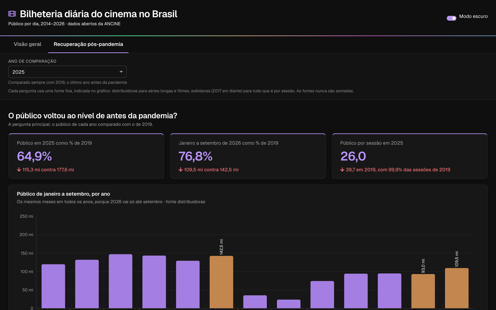
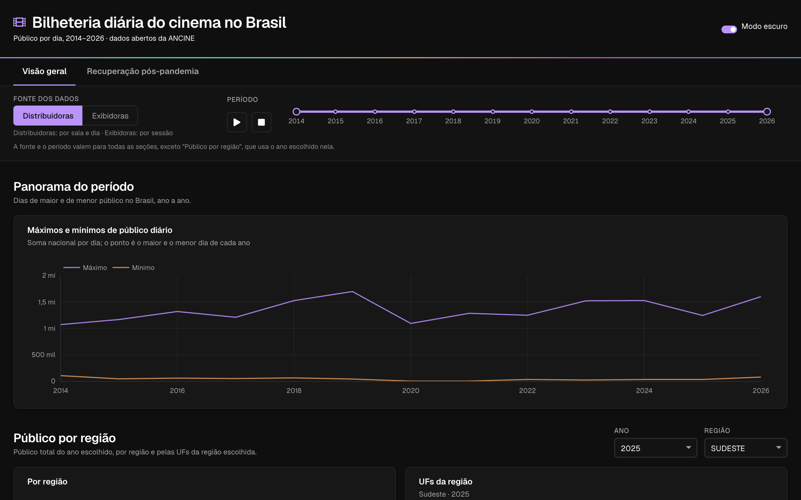

# O cinema brasileiro voltou ao nível de antes da pandemia?

Análise de **60 milhões de registros** de bilheteria diária da ANCINE (2014 a setembro de 2026), com pipeline de limpeza, notebook de análise e dashboard interativo.



## O que descobri

**Não voltou.** Em 2025, o cinema brasileiro teve **65% do público de 2019** (115 milhões de espectadores, contra 178 milhões). De janeiro a setembro de 2026, está em 77%, o primeiro avanço real desde 2023, mas ainda abaixo de qualquer ano entre 2014 e 2019.

**E não é falta de cinema.** Em 2025 havia as mesmas salas (3.595, contra 3.601 em 2019) e as mesmas sessões (4,39 milhões, contra 4,40 milhões). O que caiu foi o **público por sessão**: de 40 para 26 pessoas (−34%).

Cada pergunta de apoio explica um pedaço dessa diferença:

| Pergunta | Achado |
|---|---|
| Depende de poucos sucessos? | Cerca de dois terços da perda estão nos 10 maiores filmes do ano. Foram 27 filmes acima de 1 milhão de espectadores em 2025, contra 36 em 2019. |
| E o filme brasileiro? | Voltou a ter cerca de 10% do público, mas leva menos da metade das pessoas de 2019 (11,6 milhões, contra 24,2 milhões). |
| Oferta ou demanda? | A oferta voltou e cresceu 17% em exibições. A demanda não. As sessões sem público passaram de 3,5% para 9,2%, e se concentram à tarde. |
| Onde não voltou? | São Paulo e Rio respondem por mais da metade da diferença. O Nordeste (77%) e Santa Catarina recuperaram mais. |
| Quem ganhou espaço? | As 5 maiores distribuidoras passaram de 81% para 90% do público. Na exibição, as fatias mudaram pouco. |
| Como é a vida de um filme? | A curva é a mesma (cerca de metade do público na primeira semana). Os lançamentos ficaram mais largos: 770 salas no pico, contra 538. |
| Quando o público vai? | Sábado é o dia mais forte, junho e julho são os únicos picos que se repetem todo ano, e a faixa das 18h às 21h rende mais por sessão. |
| Dublado ou legendado? | O dublado foi de 74% do público de filmes estrangeiros em 2017 para 86% em 2025. |

A análise completa, com tabelas, gráficos e a interpretação de cada resultado, está em [`analise.ipynb`](analise.ipynb).

## Como foi feito

- **Duas fontes que não se somam.** A ANCINE publica a bilheteria por distribuidora (dia, sala e filme) e por exibidora (por sessão). As duas descrevem as mesmas exibições, então somá-las duplicaria o público. Cada pergunta usa uma só fonte, e isso está indicado em cada gráfico.
- **Co-distribuição.** Quando duas distribuidoras dividem um filme, a mesma exibição aparece duas vezes na origem. Nos totais, ela conta uma vez, com o maior público informado.
- **Comparação justa com 2026.** O ano ainda está incompleto, então toda comparação com 2026 usa os mesmos meses (janeiro a setembro) dos outros anos.
- **Escala.** O CSV limpo tem cerca de 60 milhões de linhas. O DuckDB faz as contas pesadas em SQL sobre um arquivo Parquet, e o pandas cuida do resto.
- **Verificação.** Dois testes automáticos protegem os números: `testes/verificar_numeros.py` compara 720 figuras do dashboard com uma base gravada, e `testes/verificar_recuperacao.py` confere 34 valores do dashboard contra o notebook.

As decisões em que havia mais de uma saída razoável estão registradas em [`DECISOES.md`](DECISOES.md), cada uma com o motivo.

## Dashboard

O dashboard tem duas abas:
- **Visão geral:** explora o público por UF, região, período e fonte, com rankings de filmes, distribuidoras e exibidoras.
- **Recuperação pós-pandemia:** responde à pergunta principal e às oito perguntas de apoio, com 24 gráficos e 3 indicadores. O único filtro é o ano de comparação.



O visual segue um design system próprio, com modo claro e escuro, documentado em [`DESIGN_SYSTEM.md`](DESIGN_SYSTEM.md). A paleta dos gráficos passou por checagem de contraste e de daltonismo.

### Rodar localmente

Os dados agregados que o dashboard usa (12 MB) já estão no repositório.

```bash
cd projeto_completo
python -m venv .venv
source .venv/bin/activate
pip install -r requirements.txt
python index.py
```

Depois, abra http://127.0.0.1:8050.

### Publicar

O arquivo [`render.yaml`](render.yaml) descreve o serviço para o Render (plano gratuito, 1 worker). Em produção, o app roda com `gunicorn index:server`.

## Estrutura do repositório

```
.
├── analise.ipynb          análise completa, com a interpretação de cada resultado
├── projeto_completo/      dashboard (Dash) e os CSVs agregados que ele lê
├── pipeline/              scripts que transformam os dados brutos nos CSVs do dashboard
├── testes/                verificação dos números e auditoria de layout
├── docs/                  perfil dos dados, dicionário, reconciliação e modelo SQL
├── DECISOES.md            decisões de projeto e motivos
├── DESIGN_SYSTEM.md       cores, tipografia e componentes
└── contexto.md            pergunta de negócio e regras da análise
```

## Reproduzir a análise do zero

Os dados brutos não estão no repositório: são cerca de 14 GB descompactados. Eles vêm dos dados abertos da ANCINE (bilheteria diária por distribuidora e por exibidora, em CSV). O passo a passo, do download até os CSVs do dashboard, está em [`projeto_completo/README.md`](projeto_completo/README.md).

O notebook mostra os resultados já executados, então dá para ler a análise direto no GitHub sem os dados. Para rodá-lo, instale o ambiente com `pip install -r requirements.txt` e gere `dados/bilheteria_limpa.csv.gz` pelo pipeline.

## O que esta análise não mostra

- Não há preço nem receita nos dados, então não dá para separar o efeito do preço do ingresso do efeito do interesse do público.
- Não há a capacidade das salas, então o público por sessão é uma aproximação da ocupação.
- Comparações por habitante precisariam da população do IBGE.
- A fonte das exibidoras só cobre o país todo a partir de 2017, e 2026 está incompleto.
- Tudo aqui são associações. Nada disso prova causa.

## Sobre o projeto

A arquitetura do dashboard parte de um projeto de curso sobre preços de gasolina (Dash + Plotly), descrito em [`docs/ARQUITETURA_GASPRICES.md`](docs/ARQUITETURA_GASPRICES.md). O domínio, os dados, a limpeza, a análise, as perguntas e o design são novos.

Feito por **Fernando Figueiredo**. Licença [MIT](LICENSE). Os dados são abertos e pertencem à ANCINE.
